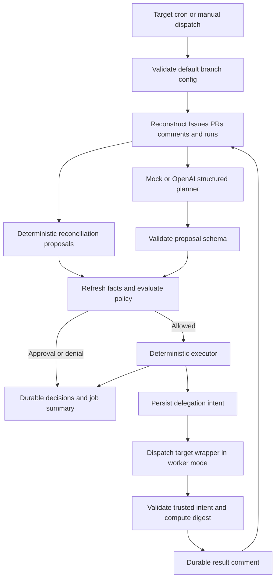

# Architecture

The stateless manager is the sole lifecycle writer. GitHub Issues and
authenticated, versioned comment events form the journal; PRs and Actions runs
supply external facts. No persistent LLM conversation is required.

## Independently testable phases

1. Initialize: `config/loadConfig`, CLI context validation, explicit workflow
   permissions and caller-level concurrency. Target is `GITHUB_REPOSITORY`, never
   the central code checkout's remote.
2. Reconcile: `GitHubClient.snapshot`, `state/reconstruct` and
   `manager/plan.reconciliationPlan` derive actions from managed Issues,
   dependencies, native PR closing links, comments and actual runs.
3. Analyze: `Planner` receives selected compact tasks. Mock picks runnable work;
   OpenAI uses strict Responses JSON schema, no tools and no GitHub credentials.
4. Validate: action schema, independent policy, fresh facts, exact authorized
   approval, run budgets, retry caps and active/uncertain execution checks.
5. Execute: fixed supported-action switch; refresh snapshot and recheck title/body
   version before mutation. Intent always precedes asynchronous dispatch.
6. Report: correlation logs, Actions summary and stable decision comments.

## Data and identities

Facts are native Issue state, labels, PR connections and Actions state. Proposals
are unprivileged structured data. Decisions record action, policy outcome and
reason. Execution state records full intent, optional run receipt and result.

Events use `<!-- dev-agent-harness:v1 -->` and fenced JSON. Trusted author allowlist
and schema validation distinguish machine events from user text. Approval commands
require current repository write permission. Unsupported event versions are ignored.
Automatic blocks record a mandatory intent before labeling. The paginated native
Issue timeline identifies the exact label application; only the first blocked-label
change after that intent can belong to it. Later human blocks are preserved. This
execution state remains mandatory when optional decision logging is disabled.

- Task version: SHA-256 of canonical title/body.
- Action ID: SHA-256 of semantic payload (excluding rationale) and complete config;
  includes the concrete retry attempt.
- Execution ID: 128 bits of SHA-256 over repository, Issue, task version, attempt.
- Follow-up identity: SHA-256 of repository and stable semantic work key, stored in
  Issue body; matching includes closed managed Issues, not similar titles.

## Lifecycle and PRs

`harness:managed` opts in. Eight exclusive states use an explicit transition
table. Other labels are preserved. Native closure maps to done; reopening maps
done back to backlog. Open PRs prevent duplicate delegation. Closed unmerged PRs
and mere references never prove completion. Only same-repository native GraphQL
`closingIssuesReferences` on a merged PR prove closure. Multiple PRs and multiple
closing references are supported. Unmanaged tasks are never changed.

Test-worker success proves a digest operation and yields awaiting-pr, never task
closure. Edited task text creates a new version. An older active execution still
occupies a slot and blocks a new execution of that task.

## Reusable workflows and extensions

Only central immutable code is checked out. The target wrapper is dispatchable;
worker mode calls the central nested worker workflow. Its relative call resolves
at the parent's workflow commit. Runtime checkout uses the matching explicit SHA.
Named secrets are passed only where needed. Permissions only downgrade across
calls. The caller owns cron and concurrency: one manager group, separate worker
execution groups. Callees do not reuse the manager lock. Worker results are
processed asynchronously in later runs.

Implement `Planner` for another provider, preserving schema/policy boundaries.
New workers must implement the versioned JSON contracts, a narrow workflow job,
trusted result channel and explicit config/dispatch registration. Workers may
suggest work, never authorize it. Do not add arbitrary API/shell actions.

References: GitHub
[reusable workflow restrictions](https://docs.github.com/en/actions/reference/workflows-and-actions/reusing-workflow-configurations),
[dispatch API](https://docs.github.com/en/rest/actions/workflows#create-a-workflow-dispatch-event),
[GITHUB_TOKEN event behavior](https://docs.github.com/en/actions/how-tos/writing-workflows/choosing-when-your-workflow-runs/triggering-a-workflow),
OpenAI [Structured Outputs](https://developers.openai.com/api/docs/guides/structured-outputs?api-mode=responses).
