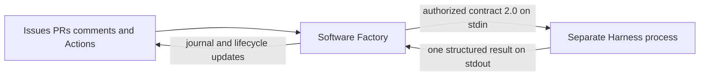

# Ownership and execution boundary

SF owns the project: objectives/scope, semantic and deterministic planning,
priorities, dependencies, action proposals, autonomy/approvals, Issue/PR state,
persistent journals, worker selection, Actions dispatch, worker supervision,
repository-wide budgets, retry decisions, cancellation decisions and reporting.

Harness owns one supplied run: request validation, technical capability checks,
execution of the selected trusted worker handler, per-run deadline/cancellation,
output bounds and result validation. It has no GitHub client or SF policy import.

SF's `executeDelegation` validates current task/version, explicit blocks, policy
identity and concrete approval. `HarnessProcessClient` maps its delegation envelope
1.0 to generic run contract 2.0 and launches the pinned CLI with a restricted
environment. No GitHub/OpenAI credential is inherited. Returned schema, execution
ID, task ID and task version are checked before SF persists a result. Only SF
interprets it for lifecycle, follow-ups or retries.

The adapter applies a subprocess deadline and output cap; the runtime also checks
its own per-run limits. Process separation is not an OS sandbox for hostile code.
The only bundled operation is the trusted digest test worker, implemented solely
in the Harness repository.

The target's wrapper owns cron and concurrency and calls a pinned SF composite
Action. This supports the private SF repository without cross-repository PATs:
GitHub downloads the authorized private action and its checked-in deterministic
bundle. Worker mode checks out only the independently pinned public Harness for
execution. `runtime.json` records that pin and contract version. CI validates the
real protocol, vendored schemas and bundle reproducibility.

Legacy `harness:*` labels and v1 journal envelopes remain SF-owned compatibility
data. Neither their interpretation nor legacy workflow recovery enters Harness.
See migration.md before switching an installation with active runs.
