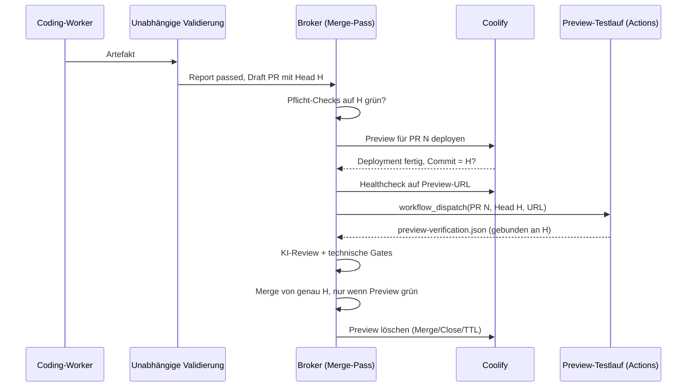

# Konzept: Preview-Umgebungen pro PR (Coolify)

Status: **Konzept, nicht implementiert.** Dieses Dokument beschreibt, wie die Factory für jeden Merge-Kandidaten eine
kurzlebige Umgebung auf Coolify bereitstellt, dort E2E- und Integrationstests laufen lässt und nur bei grünem Ergebnis
merged. Vorbild sind die Preview Deployments von Vercel, angepasst an die Garantien der Factory (gemergt wird nur der
geprüfte Head, Fehler sind genau einem PR zuordenbar, nichts Manuelles auf dem VPS).

## 1. Entscheidung: Preview pro PR statt gemeinsamem `staging`-Branch

Ein fester `staging`-Branch, in den alle Kandidaten zusammenlaufen, wurde verworfen:

- **Keine Zuordnung.** Wird ein E2E-Test rot, während drei PRs in `staging` liegen, ist offen, welcher PR schuld ist.
  Der Merge-Pass braucht aber ein Ergebnis pro PR und Head.
- **Drift.** Abgelehnte oder geänderte PRs bleiben in `staging`, bis jemand den Branch neu aufsetzt. Getestet würde ein
  Stand, der so nie auf `main` landet.
- **Bruch mit dem Broker.** Der Broker merged nur den exakt geprüften Head (`api.merge(number, f.head, …)` in
  `src/merge/manager.ts`). Ein Staging-Ergebnis hätte mit diesem Head nichts zu tun.

Stattdessen bekommt jeder Kandidat eine eigene, kurzlebige Umgebung. `staging` bleibt optional als **Spiegel von
`main`** für Smoke-Tests nach dem Merge (Abschnitt 8), nie als Sammelbecken.

## 2. Ablauf



1. **Kandidat.** Ein PR ist Kandidat, wenn er heute schon in den Merge-Pass kommt: Factory-PR eines validierten Runs
   oder gleiches Repository mit `sf:automerge`. Forks, explizit blockierte PRs und Nicht-Default-Ziele bleiben
   ausgeschlossen.
2. **Auslöser.** Erst wenn alle `merge.requiredChecks` und nativen Pflicht-Checks auf dem Head grün sind, startet die
   Preview. Rote oder laufende CI kostet so keine Server-Ressourcen.
3. **Deploy.** Der Broker löst über die Coolify-API das PR-Deployment der konfigurierten Applikation aus und wartet auf
   dessen Abschluss (`preview.deployTimeoutMinutes`).
4. **Head-Bindung.** Coolify baut den PR-Branch, nicht einen festen Commit. Der Broker vergleicht deshalb den Commit
   des fertigen Deployments mit dem erwarteten Head. Abweichung heißt: Ergebnis verwerfen, beim neuen Head neu beginnen.
5. **Gesundheit.** Der Broker prüft die Preview-URL (`preview.healthcheck`) bis zum Timeout. Erst dann laufen Tests.
6. **Tests.** Der Broker dispatcht den installierten Preview-Workflow auf einem GitHub-hosted Runner mit PR-Nummer,
   Head, URL und Verifikations-ID. Der Workflow lädt `preview-verification.json` als Artefakt hoch.
7. **Gate.** Der Merge-Pass merged nur, wenn für den aktuellen Head und Base ein gültiger, bestandener Preview-Report
   vorliegt. Alle bestehenden Gates (KI-Review, Pflicht-Checks, `CLEAN`, unveränderter Head/Base) bleiben.
8. **Aufräumen.** Nach Merge, Close oder Ablauf der TTL löscht der Broker die Preview inklusive Volumes.

Ein neuer Head (Push, Rework oder `update_branch`) macht jedes ältere Preview-Ergebnis ungültig, genau wie heute ein
KI-Review. Die bestehende Preview des PRs wird für den neuen Head neu deployt, nicht dupliziert.

## 3. Einbettung in Broker und Temporal

**Wo die Logik lebt.** Der Merge-Pass (`RuntimeMerge`, `src/runtime/merge.ts`) läuft im Hintergrund, höchstens alle
drei Minuten, und darf nicht minutenlang blockieren. Deploy, Warten auf Health und Testlauf dauern 5 bis 30 Minuten.
Deshalb startet der Merge-Pass pro `(Repository, PR, Head)` einen eigenen **Temporal-Workflow `PreviewVerification`**
mit deterministischer Workflow-ID, etwa `preview:<repoId>:<pr>:<head>`. Temporal liefert damit Idempotenz (ein Lauf
pro Head), Timeouts, Retries mit Backoff und Überleben von Broker- und Worker-Neustarts. Ein neuer Head bricht den
Workflow des alten Heads ab.

**Aktivitäten** (alle im Broker-Worker, nicht im gepinnten Coding-Executor):

| Aktivität | Zweck |
|---|---|
| `coolifyDeployPreview` | PR-Deployment anstoßen, Deployment-UUID als Effekt-Receipt speichern |
| `coolifyAwaitDeployment` | Status pollen, Commit des Deployments gegen Head prüfen |
| `awaitPreviewHealthy` | HTTP-Healthcheck auf die Preview-URL |
| `dispatchPreviewTests` | `workflow_dispatch` des Preview-Workflows, Run korrelieren wie beim Validator |
| `collectPreviewReport` | Artefakt laden, Schema und Bindung prüfen, Report plus Digest speichern |
| `coolifyDeletePreview` | Preview und Volumes löschen, idempotent |

**Durable Records.** Wie bei der Validierung speichert der Broker einen unveränderlichen Report mit Digest in
PostgreSQL. Der Report bindet: Repository-ID, PR-Nummer, Head-SHA, Base-SHA, Hash der Preview-Konfiguration,
Coolify-Deployment-UUID, deployten Commit, Actions-Run-ID und Attempt 1, Status (`passed`, `failed`, `unhealthy`,
`deploy_failed`, `timeout`, `unsupported`) und die einzelnen Checks mit Exit-Codes. Ein Report, der nicht exakt zu PR,
Head und Konfiguration passt, wird verworfen (fail closed), analog zu `bindValidation`.

**Gate im Merge-Pass.** In `mergeGate` kommt eine Regel hinzu: Ist `preview.enabled` und `preview.requiredForMerge`,
braucht der aktuelle Head einen bestandenen Report. Fehlt er, läuft er noch oder ist er rot, schreibt der Merge-Pass
den Grund in den bestehenden `merge_status`-Kommentar („Preview läuft noch“, „E2E-Test X fehlgeschlagen“) und merged
nicht. Die Autorität ist der Broker-Record, nicht ein GitHub-Status, denn die Installation hat heute keine
`statuses`/`checks`-Schreibrechte (`src/runtime/github-app.ts`). Ein Commit-Status `sf/preview` zur Anzeige in GitHub
ist optional und bräuchte diese zusätzliche App-Berechtigung.

**Reihenfolge zum KI-Review (entschieden: parallel).** KI-Review und Preview laufen unabhängig, gemergt wird erst,
wenn beide grün sind. So verlängert die Preview die Durchlaufzeit nur, wenn sie langsamer ist als das Review. Die
Alternative „Review erst nach grüner Preview“ spart KI-Kosten und bleibt eine spätere Option.

**Rework (Phase 3).** Mit `execution.rework: true` könnte ein roter Preview-Test wie eine fehlgeschlagene Validierung
einen weiteren Versuch starten, mit den fehlgeschlagenen Tests und dem gekürzten Log als `contextReferences`. Das
setzt voraus, dass Preview-Fehler zuverlässig sind (keine flaky Tests), und kommt deshalb erst nach einer Bewährungszeit.

## 4. Konfiguration pro Repository

Alles ist pro Repository schaltbar und standardmäßig **aus**, damit bestehende Installationen unverändert bleiben.

**Ort.** Ein neuer Abschnitt `preview` in `.github/software-factory.yml`, neben `merge` und `deploy`. Begründung: Das
Gate wirkt auf PR-Heads zur Merge-Zeit, auch für adoptierte `sf:automerge`-PRs ohne Coding-Run. Die Validierungs-Datei
`.github/software-factory.validation.json` wird dagegen beim Admit eines Coding-Runs eingefroren und passt deshalb
nicht. Das Schema kommt wie alle Settings aus der Zod-Quelle (`src/config/index.ts`), wird in
`schemas/config.schema.json` generiert und in `docs/configuration.md` dokumentiert.

```yaml
preview:
  enabled: false                 # Hauptschalter, Default aus
  requiredForMerge: true         # false = nur informativ, blockiert keinen Merge
  provider: coolify              # vorerst einziger Provider
  coolify:
    applicationUuid: zbcublpxuhb2hfneqpdbnddr   # Coolify-App, deren PR-Previews genutzt werden
  trigger: checks                # Preview erst nach grünen Pflicht-Checks
  deployTimeoutMinutes: 20       # 5–60
  healthcheck:
    path: /                      # relativ zur Preview-URL
    expectStatus: 200
    timeoutSeconds: 300          # 30–1800
  tests:
    workflow: factory-preview.yml   # installierter Wrapper, vom Manager ausgerollt
    command: npm run test:e2e:preview
    timeoutMinutes: 20           # 1–60
    environment: sf-preview      # GitHub-Environment mit Test-Zugangsdaten
  maxConcurrent: 1               # gleichzeitige Previews dieses Repos, 1–5
  ttlHours: 24                   # Previews ohne Aktivität werden danach gelöscht
  smoke:
    enabled: false               # optional: Smoke-Test gegen staging nach Merge
    url: null
    command: null
```

Regeln, die die Validierung beim Lesen erzwingt: `applicationUuid` ist Pflicht, wenn `enabled`; `tests.workflow` muss
installiert sein, sonst wird das Gate als „nicht eingerichtet“ gemeldet (blockiert, kein stiller Durchlauf);
`requiredForMerge: true` setzt `merge.enabled` voraus; das Kommando ist ein einzelnes Literal ohne `${{`.

**SF Manager.**

- **Rollout-Dialog** (`src/components/temporal-rollout.tsx`): neuer aufklappbarer Abschnitt „Preview & E2E“ neben dem
  Validierungsplan. Er zeigt Schalter, Coolify-App (Auswahlliste aus der Coolify-API, read-only abgefragt über den
  Broker), Test-Kommando und Timeouts. Der Manager schreibt die Werte in die Konfiguration des Rollout-PRs, wie heute
  die Validierungsdatei.
- **Config-Editor** (`src/components/config-editor.tsx`): bearbeitet `preview` wie jeden anderen Abschnitt, Schema aus
  dem Installationsvertrag.
- **Installationsvertrag**: Der Preview-Wrapper `factory-preview.yml` wird eine weitere versionierte Datei in
  `installation-contract.json`. Er wird nur installiert, wenn `preview.enabled`, und wie alle Wrapper ausschließlich
  über den Manager ausgerollt.
- **Prüfung vor dem Rollout**: Der Manager lässt den Broker prüfen, ob die App existiert, Previews aktiviert sind und
  eine URL-Vorlage hat, und zeigt das Ergebnis im Dialog. Kein Rollout mit `enabled: true` auf eine nicht erreichbare App.

## 5. Zugangsdaten und Geheimnisse

| Geheimnis | Ort | Wer liest es |
|---|---|---|
| Coolify-API-Token | Secret `BROKER_COOLIFY_API_TOKEN` im Environment `production` von `software-factory`, per `deploy-env` in `.sf-deploy.env` | nur der Broker |
| Coolify-Basis-URL | dieselbe Route als `COOLIFY_BASE_URL`, kein Geheimnis | Broker |
| Test-Zugangsdaten für Integrationen | GitHub-Environment `sf-preview` des Ziel-Repos, vom Manager-Vault zugestellt | nur der Preview-Testjob |
| Laufzeit-Variablen der Preview | Coolify „Preview“-Variablen der App | die Preview-Container |

- Das Coolify-Token kommt wie `BROKER_OPENAI_API_KEY` über das Deploy, nie per Hand auf den VPS. Es braucht die
  Fähigkeiten `read` und `deploy` sowie das Löschen von Previews, nicht mehr. Coolify-Tokens gelten pro Team; deshalb
  gehören Produktivressourcen, die die Factory nie anfassen soll, perspektivisch in ein eigenes Team.
- Der Preview-Testjob bekommt nur Test-Zugangsdaten (Sandbox-Konten, Test-Mandanten, Mail-Catcher), nie
  Produktiv-Secrets, Modell- oder Broker-Keys. Die reservierten Namen der Validierung gelten auch hier.
- Der Coding-Worker sieht weder Preview-URL-Zugangsdaten noch Test-Secrets.

**Befund im aktuellen Setup (Controla).** Die App hat Preview-Variablen für `MAIL_PASSWORD`, `CORE_API_TOKEN`,
`CONTROLA_SECURITY_MASTER_KEY`, `JWT_SECRET` und `SPRING_DATASOURCE_PASSWORD`. Coolify legt diese standardmäßig als
Kopie der Produktivwerte an. Die Werte habe ich nicht gelesen. Vor dem Einschalten muss geklärt sein, dass alle
Preview-Werte Sandbox-Werte sind, sonst schreibt jede Preview in echte Integrationen (Mailversand, Core-API).

## 6. Datenbank und Seed-Daten pro Preview

- **Eigene Datenbank.** Controla nutzt das Compose-Buildpack. Coolify startet für jedes PR-Deployment den ganzen Stack
  inklusive Postgres-Container mit eigenen, PR-spezifischen Volumes. Damit hat jede Preview automatisch eine leere,
  isolierte Datenbank. Eine geteilte Datenbank für alle Previews ist ausgeschlossen.
- **Schema.** Migrationen (Flyway/Liquibase) laufen beim Start der App wie in Produktion. Damit prüft die Preview auch
  die Migration selbst.
- **Seed.** Die Anwendung bringt ihre Seed-Daten selbst mit, etwa über ein Profil (`SPRING_PROFILES_ACTIVE=preview`)
  mit Seed-Migrationen oder einen idempotenten Seed-Endpunkt, den der Testlauf als ersten Schritt aufruft. Die Factory
  setzt nur die Variable, sie kennt keine Daten. Seed-Daten liegen versioniert im Repo, damit Fehler reproduzierbar sind.
- **Nie Produktivdaten.** Kein Dump, keine Kopie, kein Anonymisierungsschritt in der Preview-Pipeline.
- **Aufräumen.** Beim Löschen der Preview werden die Volumes mit entfernt. Die TTL fängt Previews ab, deren Löschung
  fehlgeschlagen ist.

## 7. Server-Ressourcen

Stand heute (read-only geprüft): Coolify 4.7.5 mit genau einem Server (`localhost`), eine Applikation (Controla,
Environment `staging`, Branch `main`, Domain `controla.test.digitalsmallbusiness.de`), Preview-Vorlage
`{{pr_id}}.{{domain}}`, keine laufenden Previews. Sentinel-Metriken sind aus, der App-Healthcheck ebenfalls.

- **Bedarf.** Eine Controla-Preview ist ein voller Stack (Frontend, Backend, Postgres), grob 1 bis 2 GB RAM plus
  Build-Last. Builds sind der teure Teil; sie laufen auf demselben Server wie die Produktiv- bzw. Staging-App.
- **Begrenzung.** `preview.maxConcurrent` pro Repository (Default 1) und ein globales Limit im Broker. Überzählige
  Kandidaten warten in der Reihenfolge des Merge-Passes. TTL und Löschen nach Merge/Close halten den Bestand klein.
- **Ressourcenlimits.** Preview-Container bekommen in Coolify Memory-/CPU-Limits, damit eine Preview nie die
  Produktiv-App verdrängt.
- **Messen vor Skalieren.** Sentinel-Metriken in Coolify einschalten (Einstellung in Coolify, nicht auf dem VPS), damit
  der Broker vor einem Deploy freien Speicher prüfen und sonst warten kann. Reicht ein Server nicht, kommt ein eigener
  Build-/Preview-Server als zweites Coolify-Ziel dazu.
- **Domains.** Die Vorlage braucht Wildcard-DNS `*.controla.test.digitalsmallbusiness.de` auf den Coolify-Server und
  Zertifikate für die Subdomains. Previews sind öffentlich erreichbar; deshalb Basic Auth (Coolify-Funktion) und
  `noindex`. Die Zugangsdaten dafür liegen im Environment `sf-preview`.

## 8. Optional: `staging` als Spiegel von `main`

Die bestehende Controla-App im Coolify-Environment `staging` folgt bereits `main`. Nach einem bestätigten Merge kann
der Broker deren Deployment abwarten und einen kurzen Smoke-Test (`preview.smoke`) dagegen laufen lassen. Ein roter
Smoke-Test blockiert nichts rückwirkend, sondern erzeugt eine Meldung (Slack/Issue). Er prüft, wie mehrere gemergte
Änderungen zusammenspielen, und ist der Ort für länger laufende Integrationstests, die pro PR zu teuer wären.

## 9. Auslösen der Previews: API statt Webhook

Die Controla-App hängt an der Quelle „Public GitHub“, nicht an einer GitHub-App. Coolify bekommt damit keine
PR-Webhooks und legt Previews nicht selbstständig an oder ab. Das passt zum Konzept: Die Factory löst Previews
gezielt über die API aus, nur für Kandidaten und nur nach grüner CI, und löscht sie selbst. Eine automatische
Preview pro PR durch Coolify ist nicht nötig und würde Ressourcen für PRs verbrauchen, die nie Kandidat werden.
Zu verifizieren in Phase 1: der genaue API-Aufruf für ein PR-Deployment (`deploy` mit PR-Nummer) und für das Löschen
einer Preview in Coolify 4.7.5, und dass ein Deployment den gebauten Commit zurückmeldet.

## 10. Fehlerfälle

| Fall | Verhalten |
|---|---|
| Coolify nicht erreichbar / Token fehlt | Kein Merge, Grund im PR, Retry beim nächsten Pass |
| Build oder Deploy fehlgeschlagen | Report `deploy_failed`, kein Merge, Log-Zusammenfassung im PR |
| Deployter Commit ≠ Head | Ergebnis verwerfen, beim aktuellen Head neu starten |
| Healthcheck läuft in Timeout | Report `unhealthy`, kein Merge |
| Testlauf rot | Report `failed` mit fehlgeschlagenen Tests, kein Merge |
| Preview-Workflow nicht installiert | „nicht eingerichtet“, blockiert, nie stilles Bestehen |
| Kapazität erschöpft | Warten, Grund im PR |
| Löschen fehlgeschlagen | Retry, spätestens TTL-Sweep |
| Unklarer Ausgang (Antwort verloren) | Effekt-Receipt und Abgleich über Coolify-Deployment-Liste, kein zweites Deploy |

## 11. Umsetzung in Phasen

1. **Vorbereitung Coolify (Controla).** Preview-Variablen auf Sandbox-Werte prüfen, Wildcard-DNS und Basic Auth,
   Ressourcenlimits, Sentinel an, API-Aufrufe aus Abschnitt 9 verifizieren, Coolify-Token als
   `BROKER_COOLIFY_API_TOKEN` hinterlegen. Alles über Coolify und Deploy, nichts per Hand auf dem VPS.
2. **Factory.** Config-Schema `preview`, Coolify-Client, Temporal-Workflow `PreviewVerification`, Report-Schema und
   Bindung, Gate in `mergeGate`, Cleanup und TTL, Wrapper `factory-preview.yml` im Installationsvertrag, Tests nach
   dem Muster der Validierung (gefälschter/fremder Report, falscher Commit, Timeout, Antwortverlust).
3. **SF Manager.** Abschnitt „Preview & E2E“ im Rollout-Dialog und Config-Editor, Broker-Prüfung der Coolify-App,
   Zustellung der `sf-preview`-Secrets aus dem Vault. Rollout auf Controla ausschließlich über den Manager, zuerst mit
   `requiredForMerge: false` (nur beobachten), danach scharf.
4. **Ausbau.** Rework bei roter Preview, Smoke-Test gegen `staging`, optional Commit-Status `sf/preview` in GitHub,
   eigener Preview-Server bei Bedarf.

## 12. Offene Entscheidungen

Entschieden: Preview und KI-Review laufen parallel (Abschnitt 3).


- Eigenes Coolify-Team für die Factory, damit das Token keine Produktivressourcen erreicht?
- Bleiben Previews auf demselben Server wie `staging`, oder gleich ein separater Preview-Server?
- Soll die Factory `statuses: write` bekommen, damit das Ergebnis auch als Check in GitHub sichtbar ist?
