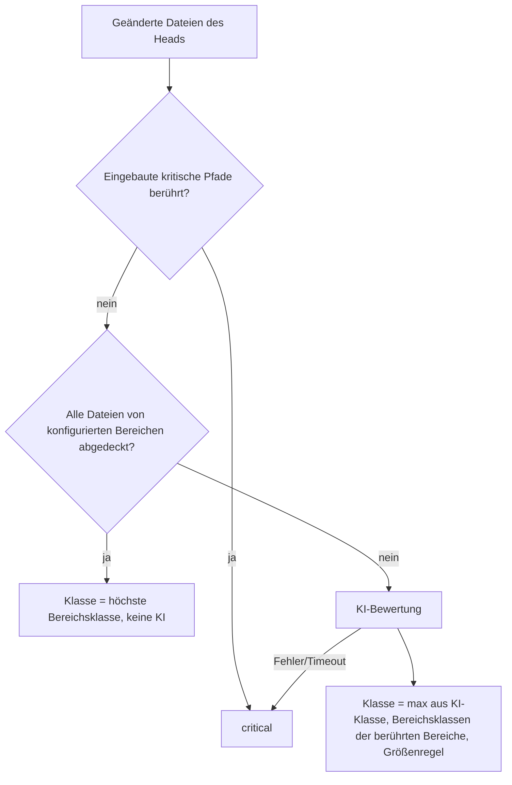

# Konzept: Risikobasiertes Auto-Merge

Status: **Konzept, nicht implementiert.** Dieses Dokument beschreibt, wie die Factory für jeden Merge-Kandidaten eine
Risikoklasse bestimmt und davon abhängig macht, ob der Broker selbst merged oder eine menschliche Freigabe verlangt.
Die Risikobewertung erfolgt standardmäßig durch KI. Pro Repository lassen sich Bereiche (Pfade) mit festen
Risikoklassen hinterlegen, die die KI-Bewertung ergänzen oder ersetzen.

## 1. Ausgangslage

Heute gibt es pro Repository genau eine Einstellung für alle PRs (`autonomy.overrides.merge_pr`, siehe
[merging.md](merging.md)):

- `deny`: Die Factory merged nie.
- `approval`: Jeder Merge braucht `/harness approve <id>` von einer berechtigten Person.
- `allow`: Jeder PR, den das KI-Review mit `merge` freigibt und der alle technischen Gates besteht, wird gemergt.

Damit wird eine Doku-Korrektur genauso behandelt wie eine Datenbankmigration oder eine Änderung an der
Authentifizierung. Wer `allow` wählt, nimmt alles automatisch, wer `approval` wählt, muss alles freigeben. Das
risikobasierte Auto-Merge schiebt eine Stufe dazwischen: **Der Broker merged selbst, was als risikoarm eingestuft ist,
und legt den Rest einem Menschen vor.**

Wichtig: Das KI-Review (`merge_review`) beantwortet „Ist der Code korrekt und mergebar?“. Die Risikobewertung beantwortet
eine andere Frage: „Wie schlimm wäre es, wenn das Review sich irrt?“ Ein korrekt aussehender PR an der
Zahlungsabwicklung bleibt riskant. Deshalb ist die Bewertung ein eigener Schritt mit eigenem Ergebnis, nicht ein
weiteres Feld im Review.

## 2. Grundprinzipien

1. **Nur verschärfen, nie lockern.** Die Risikobewertung entscheidet nur zwischen `allow` und `approval`. Sie setzt
   `merge_pr: allow` voraus. Steht `merge_pr` auf `approval`, ist die Bewertung rein informativ, steht es auf `deny`,
   läuft sie gar nicht. Ein Repository, das heute alles freigeben muss, merged durch dieses Feature nicht plötzlich
   selbst.
2. **Alle bestehenden Gates bleiben.** Eine niedrige Risikoklasse ersetzt weder KI-Review, Pflicht-Checks, `CLEAN`,
   unveränderten Head/Base noch (wenn aktiviert) die Preview. Sie ist eine zusätzliche Bedingung für den autonomen
   Merge, keine Abkürzung.
3. **Fail closed.** Ist die Bewertung nicht verfügbar, unvollständig oder unklar, gilt die höchste Klasse. Der PR wird
   dann nicht automatisch gemergt, sondern zur Freigabe vorgelegt.
4. **Regeln schlagen KI nach oben.** Konfigurierte Bereiche setzen eine Mindestklasse, die die KI nicht unterschreiten
   kann. Senken können Bereiche die Klasse nur, wenn ein PR ausschließlich Dateien dieser Bereiche ändert (Abschnitt 4).
5. **Gebunden an den Head.** Eine Bewertung gilt für genau einen Head, eine Base und eine Risiko-Konfiguration. Jeder
   neue Push, jede Branch-Aktualisierung und jede Konfigurationsänderung macht sie ungültig, wie heute beim KI-Review.
6. **Standardmäßig aus.** Bestehende Installationen verhalten sich unverändert, bis die Option über den SF Manager
   eingeschaltet wird.

## 3. Risikoklassen und Schwelle

Vier Klassen, absichtlich grob, damit Regeln und KI dieselbe Sprache sprechen:

| Klasse | Bedeutung | Beispiele |
|---|---|---|
| `low` | Fehler wären sofort sichtbar und folgenlos rückgängig zu machen | Doku, Texte, Tests, isolierte UI-Anpassung, Refactoring ohne Verhaltensänderung |
| `medium` | Verhalten ändert sich in einem abgegrenzten Bereich, gut durch Tests abgedeckt | neues Feature hinter vorhandener Struktur, Bugfix in Fachlogik, Abhängigkeits-Patch |
| `high` | Fehler hätten Wirkung auf Daten, Sicherheit, Geld oder viele Nutzer | Datenbankmigration, Auth/Rechte, Zahlungslogik, öffentliche API, Konfiguration der Laufzeit |
| `critical` | Änderung an der Kontrolle selbst oder irreversible Wirkung | CI-Workflows, Factory-Konfiguration, `AGENTS.md`, Deploy-/Infrastruktur, Löschen von Daten |

Die Schwelle `merge.risk.autoMergeUpTo` legt fest, bis zu welcher Klasse der Broker selbst merged (Default `medium`,
erlaubt `low`, `medium`, `high`). `critical` wird **nie** automatisch gemergt, unabhängig von der Schwelle.

## 4. Wie die Klasse entsteht



**Schritt 1: Eingebaute kritische Pfade.** Unabhängig von der Konfiguration gelten als `critical`:
`.github/workflows/**`, `.github/software-factory.yml`, `.github/software-factory.validation.json`, `AGENTS.md`,
`CODEOWNERS`, `.github/CODEOWNERS` und die vom Installationsvertrag verwalteten Dateien. Ein PR, der das Regelwerk der
Factory selbst ändert, darf sich nicht selbst freigeben. Diese Liste ist im Code fest und nicht absenkbar.

**Schritt 2: Konfigurierte Bereiche.** Jeder Bereich ist eine Liste von Glob-Mustern mit einer Klasse. Zwei Fälle:

- **Vollständig abgedeckt.** Ändert ein PR nur Dateien, die von Bereichen erfasst sind, ist die Klasse das Maximum der
  Klassen dieser Bereiche. Die KI wird nicht gefragt. Beispiel: `docs/**` ist `low`, ein reiner Doku-PR ist `low`, ohne
  Modellkosten. So können Bereiche die Klasse auch **senken**.
- **Teilweise abgedeckt.** Ändert ein PR zusätzlich andere Dateien, bewertet die KI. Die Klassen der berührten Bereiche
  wirken dann als **Mindestklasse**. Beispiel: `db/migrations/**` ist `high`, ein PR mit Migration und Service-Code ist
  mindestens `high`, auch wenn die KI `medium` sagt. Ein `low`-Bereich senkt in diesem Fall nichts.

Diese Regel ist bewusst einfach: Senken nur bei voller Abdeckung, sonst wirken Bereiche nur nach oben. Damit kann ein
PR nicht riskanten Code „im Windschatten“ einer Doku-Änderung als `low` durchbringen.

**Schritt 3: KI-Bewertung.** Ein eigener Modellaufruf (`RiskAssessor`, analog zu `OpenAIMergeReviewer`) liefert ein
strukturiertes Ergebnis:

```json
{
  "class": "medium",
  "reason": "Ändert die Berechnung der Rechnungssumme in einem Service, Tests decken den Fall ab.",
  "factors": [
    { "factor": "business_logic", "path": "src/billing/invoice.ts", "explanation": "…" },
    { "factor": "test_coverage", "path": "src/billing/invoice.test.ts", "explanation": "…" }
  ]
}
```

Eingaben: vollständiger Diff und geänderte Dateien (dieselben Grenzen wie das Review, `maxFiles`/`maxContextBytes`),
die Liste der berührten Bereiche, deterministische Kennzahlen (Anzahl Dateien, geänderte Zeilen, berührte
Top-Level-Verzeichnisse, ob Tests geändert wurden) und die vertrauenswürdige Bereichs- und Klassenbeschreibung aus der
Konfiguration des Default-Branchs. **Nicht** als Eingabe: PR-Titel, PR-Text, Kommentare und Issue-Text. Diese Texte
sind vom Autor kontrolliert und das naheliegende Mittel, um ein Modell zu „das ist harmlos“ zu überreden. Die
Bewertung stützt sich nur auf das, was der Code tatsächlich ändert.

Faktoren (feste Aufzählung, damit Auswertungen möglich sind): `data_schema`, `data_loss`, `security`, `auth`,
`payments`, `external_integration`, `public_api`, `runtime_config`, `dependency`, `business_logic`, `ui`, `docs`,
`tests`, `test_coverage`, `size`.

**Schritt 4: Größenregel.** Zusätzlich deterministisch: Überschreitet die Änderung `merge.risk.maxLowRiskLines`
geänderte Zeilen (Default 300), ist die Klasse mindestens `medium`. Große Änderungen sind schwer zu überblicken, egal was
sie berühren.

**Ergebnis.** `class = max(KI, Mindestklassen der Bereiche, Größenregel)`, bzw. `critical`, wenn eingebaute Pfade
berührt sind. Die Herkunft wird mitgespeichert (`source: builtin | areas | ai`), damit im PR sichtbar ist, warum eine
Klasse gilt.

## 5. Einbettung in den Merge-Pass und Temporal

**Zeitpunkt.** Die Bewertung startet an derselben Stelle wie das KI-Review: erst wenn alle Pflicht-Checks auf dem Head
grün sind. Rote oder laufende CI kostet keinen Modellaufruf.

**Parallel zu Review und Preview.** Risikobewertung, KI-Review und (geplant) Preview sind voneinander unabhängig und
laufen parallel. Gemergt wird erst, wenn alle drei vorliegen. Die Bewertung ist mit 1 bis 2 Minuten so kurz wie das
Review und läuft deshalb wie das Review direkt im Merge-Pass (`MergeManager`), nicht als eigener Temporal-Workflow. Im
Code bedeutet das: `review` und `assessRisk` werden gemeinsam gestartet und gemeinsam abgewartet. Für einen reinen
Bereichs-PR (Abschnitt 4, Schritt 2, voll abgedeckt) entfällt der Modellaufruf.

**Durable Record.** Wie `merge_review` wird die Bewertung als Journal-Event `merge_risk` am PR gespeichert:

```text
merge_risk { head, base, riskKey, class, source, matchedAreas[], factors[], reason, threshold, decision: auto|approval }
```

`riskKey = hash(protocol, repository, head, base, Diff-Kennzahlen, merge.risk-Konfiguration, eingebaute Pfadliste)`.
Liegt für den aktuellen `riskKey` ein Event vor, wird es wiederverwendet; sonst wird neu bewertet. So entsteht pro Head
genau eine Bewertung, auch über Broker-Neustarts.

**Gate.** Nach dem KI-Review (`decision: merge`) und vor `mergeGate` entscheidet die Klasse:

```text
merge_pr == deny                         -> wie heute: nichts
merge_pr == approval                     -> wie heute: Freigabe nötig (Risiko nur angezeigt)
merge_pr == allow, risk.enabled == false -> wie heute: autonomer Merge
merge_pr == allow, risk.enabled == true:
   class <= autoMergeUpTo und != critical -> autonomer Merge (alle Gates wie bisher)
   sonst, aboveThreshold == approval       -> /harness approve <id>, id bindet zusätzlich riskKey und class
   sonst, aboveThreshold == block          -> kein Merge, Grund im PR, Mensch merged selbst
```

Die Freigabe nutzt den bestehenden Mechanismus. Die `approvalId` enthält zusätzlich `riskKey`, damit eine Freigabe nur
für genau die bewertete Fassung gilt.

**Branch-Aktualisierung.** `update_branch` ist kein Merge und erzeugt ohnehin einen neuen Head mit neuem Review und
neuer Bewertung. Im Risiko-Modus braucht die Aktualisierung deshalb keine Freigabe; erst der Merge des neuen Heads
wird nach seiner Klasse entschieden. Sonst müsste ein Mensch hochriskante PRs zweimal freigeben.

**Sichtbarkeit.**

- Die Merge-Status-Meldung am PR zeigt Klasse, Herkunft, Gründe und berührte Bereiche, z. B. „Risiko **high**
  (Bereich `db/migrations/**`, KI: medium). Automatischer Merge nur bis `low`. Freigabe: `/harness approve …`“.
- Ein Label `sf:risk-low|medium|high|critical` macht die Klasse in PR-Listen filterbar. Es ist reine Anzeige, der
  Merge-Pass liest es nie als Freigabe. Der Broker setzt und entfernt es selbst.
- Optional ein Commit-Status `sf/risk`, sobald `statuses: write` mit der Preview ohnehin kommt.
- Benachrichtigung: Wartet ein PR wegen seiner Klasse auf Freigabe, geht eine Slack-Nachricht über den bestehenden
  Benachrichtigungsweg raus, damit die Freigabe nicht liegen bleibt.

**Actions-Modus.** Der `MergeManager` ist in Temporal-Broker und Actions-Merge-Job derselbe Code. Die Bewertung
funktioniert in beiden, der Modellschlüssel ist dort jeweils schon für das Review vorhanden.

## 6. Konfiguration pro Repository

Neuer Unterabschnitt `merge.risk` in `.github/software-factory.yml`, weil die Bewertung ausschließlich den Merge
steuert. Schema aus der Zod-Quelle (`src/config/index.ts`), generiert in `schemas/config.schema.json`, dokumentiert in
`docs/configuration.md`. Die Konfiguration wird wie heute vom Default-Branch gelesen, nie vom PR-Head. Ein PR kann seine
eigenen Bereiche also nicht umdefinieren; Änderungen an der Datei sind ohnehin `critical`.

```yaml
merge:
  enabled: true
  # … bestehende Felder …
  risk:
    enabled: false              # Hauptschalter, Default aus
    mode: enforce               # observe = nur bewerten und anzeigen, nichts blockieren
    autoMergeUpTo: medium       # low | medium | high; critical nie
    aboveThreshold: approval    # approval = /harness approve, block = Mensch merged selbst
    maxLowRiskLines: 300        # mehr geänderte Zeilen: mindestens medium
    assessor:
      provider: llm             # wie merge.review.provider; mock bewertet immer critical
      model: gpt-6.1-sol
      reasoningEffort: medium
      timeoutSeconds: 90
    areas:
      - name: Dokumentation
        paths: ['docs/**', '**/*.md']
        class: low
      - name: Tests
        paths: ['**/*.test.ts', 'src/test/**']
        class: low
      - name: Datenbankmigrationen
        paths: ['src/main/resources/db/migration/**']
        class: high
      - name: Sicherheit
        paths: ['src/main/java/**/security/**']
        class: high
      - name: Deployment
        paths: ['compose.yaml', 'Dockerfile', 'infra/**']
        class: critical
```

Regeln, die die Validierung beim Lesen erzwingt: `risk.enabled` setzt `merge.enabled` voraus; höchstens 30 Bereiche mit
je höchstens 20 Mustern; Muster sind relative Globs ohne `..`; `autoMergeUpTo` darf nicht `critical` sein. Bei
`mode: observe` wird bewertet und angezeigt, das Gate verhält sich aber wie ohne Risiko-Modus. Damit lässt sich die
Kalibrierung an echten PRs prüfen, bevor sie etwas blockiert.

**Prompt der KI.** Die Klassenbeschreibungen aus Abschnitt 3 sind im Prompt fest. Ein optionales Feld
`risk.guidance` (kurzer Freitext, höchstens 2000 Zeichen, vom Default-Branch) kann projektspezifische Hinweise geben,
etwa „Alles unter `billing/` betrifft Geld“. Es gilt als vertrauenswürdige Anweisung wie `AGENTS.md`.

## 7. SF Manager

- **Config-Editor** (`src/components/config-editor.tsx`): `merge.risk` erscheint automatisch über das Schema im
  Formularmodus. Für die Bereiche bekommt der Schema-Editor eine Tabellenansicht (Name, Muster, Klasse), weil die
  generische Array-Darstellung für Glob-Listen unhandlich ist.
- **Abschnitt „Merge & Risiko“ im Repository** (neben „Konfiguration“): Schalter, Modus, Schwelle, Verhalten oberhalb
  der Schwelle, Bereiche. Der Manager schreibt die Werte wie jede andere Konfigurationsänderung als Entwurf und PR in
  `.github/software-factory.yml`.
- **Bereichs-Vorschau.** Beim Bearbeiten eines Bereichs zeigt der Manager, welche Dateien des Default-Branchs die Muster
  treffen (read-only über die GitHub-API). Tippfehler in Globs fallen so sofort auf.
- **Kalibrierung.** Eine Ansicht pro Repository listet die letzten Bewertungen (aus den `merge_risk`-Events): PR,
  Klasse, Herkunft, Entscheidung (auto/Freigabe), später gemergt oder revertiert. Damit lässt sich im Modus `observe`
  sehen, wie viele PRs bei welcher Schwelle automatisch gelaufen wären.
- **Rollout.** Das Feature braucht eine neue Factory-Version mit dem erweiterten Schema. Sie wird wie jede Version
  ausschließlich über den SF Manager ausgerollt. Neue Wrapper-Dateien sind nicht nötig, weil die Bewertung im
  bestehenden Merge-Pfad läuft. Der Manager verhindert `risk.enabled: true` auf einer Factory-Version, die das Feld
  nicht kennt (Schema aus dem Installationsvertrag).

## 8. Fehlerfälle

| Fall | Verhalten |
|---|---|
| Modell nicht erreichbar, Timeout, Ablehnung | Klasse `critical` (`source: error`), Freigabe nötig, Grund im PR |
| Diff zu groß oder binär für vollständige Bewertung | `critical`, wie beim Review keine Bewertung auf gekürzter Basis |
| Ungültige Ausgabe der KI | `critical` |
| Ungültiges Glob-Muster in `areas` | Konfiguration ungültig, Merge-Pass meldet „nicht eingerichtet“, kein stiller Durchlauf |
| Neuer Head während der Bewertung | Ergebnis verwerfen, beim nächsten Pass neu bewerten |
| Freigabe für alte Bewertung | Ungültig, weil `approvalId` den `riskKey` enthält |
| Label `sf:risk-*` manuell geändert | Ohne Wirkung; der Broker setzt es beim nächsten Pass zurück |

## 9. Umsetzung in Phasen

1. **Factory.** Schema `merge.risk`, Glob-Matcher (kleine eigene Implementierung oder `picomatch`), eingebaute
   kritische Pfade, `RiskAssessor` mit Schema und Prompt, Kombination der Klassen, Journal-Event `merge_risk`, Gate im
   `MergeManager`, `approvalId` mit `riskKey`, Label `sf:risk-*`, Tests nach dem Muster des Reviews (Prompt-Injection im
   Diff, Modellfehler, Teil-/Vollabdeckung, eingebaute Pfade, neuer Head, Freigabe für alte Bewertung).
2. **SF Manager.** Abschnitt „Merge & Risiko“, Bereichs-Tabelle mit Vorschau, Kalibrierungsansicht.
3. **Rollout Controla.** Neue Version über den Manager, direkt `risk.enabled: true` mit `mode: enforce` und
   `autoMergeUpTo: medium` (entschieden, ohne vorgeschaltete Beobachtungsphase). Bereiche anhand der
   Kalibrierungsansicht laufend schärfen.
4. **Ausbau.** Preview für reine `low`-Bereichs-PRs
   optional überspringen; Rückkopplung aus Reverts (ein revertierter Auto-Merge erzeugt einen Hinweis zur Bereichs-
   oder Schwellenanpassung).

## 10. Offene Fragen und Empfehlungen

1. **Was passiert oberhalb der Schwelle?** Freigabe per `/harness approve` (Empfehlung) oder nur blockieren und ein
   Mensch merged selbst. Empfehlung: `approval` als Default, weil damit alle Gates des Brokers auch für riskante PRs
   gelten und nur die Freigabe menschlich ist.
2. **Eigener KI-Aufruf oder Feld im Review?** Empfehlung: eigener Aufruf, parallel zum Review. Er sieht keinen PR-Text,
   ist dadurch schwerer zu manipulieren, und die Frage „korrekt?“ vermischt sich nicht mit „wie riskant?“. Kosten:
   ein zusätzlicher Aufruf pro Head, mit `reasoningEffort: medium` und entfällt bei reinen Bereichs-PRs.
3. **Darf der Risiko-Modus `merge_pr: approval` lockern** (also `low` automatisch mergen, obwohl sonst alles
   freigegeben werden muss)? Empfehlung: nein. Wer risikobasiert mergen will, stellt bewusst auf `allow` und nutzt die
   Schwelle als Bremse. So bleibt `allow` die einzige Stelle, an der autonomes Mergen erlaubt wird.
4. **Default-Schwelle.** Entschieden: `medium`. Doku, Tests, kleine Anpassungen und abgegrenzte Fachlogik laufen
   automatisch; Migrationen, Sicherheit, Geld und öffentliche APIs (`high`) brauchen Freigabe.
5. **Wirkung auf Controla heute.** Entschieden: Controla geht direkt mit `mode: enforce` und `autoMergeUpTo: medium`
   live, ohne zweiwöchige Beobachtungsphase. `observe` bleibt als Option für andere Repositories.
6. **Eingebaute kritische Pfade nicht absenkbar?** Empfehlung: ja, fest im Code. Eine Factory, die ihre eigenen
   Workflows oder ihre Konfiguration autonom ändert, kann ihre Gates aushebeln.
7. **Label `sf:risk-*` und Commit-Status `sf/risk`.** Empfehlung: Label ja (sofort nützlich zum Filtern), Commit-Status
   erst zusammen mit `sf/preview`, weil dafür `statuses: write` nötig ist.
8. **Dürfen Labels die Klasse übersteuern** (z. B. ein Maintainer setzt `sf:risk-low`)? Empfehlung: nein, zumindest nicht
   in der ersten Version. Senken nur über Bereiche im Default-Branch, also über einen geprüften Konfigurationsmerge.
   Ein Maintainer, der einen riskanten PR durchwinken will, nutzt `/harness approve`.
